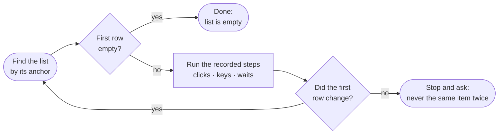

<p align="center">
  
</p>

<h1 align="center">AutoClicker Visual</h1>

<p align="center">
  Record the clicks for one item of a list once.<br>
  AutoClicker Visual repeats them for every item until the list is empty.
</p>

<p align="center">
  <a href="https://github.com/anderescaray/autoclicker/actions/workflows/ci.yml"></a>
  
  
  <a href="LICENSE"></a>
</p>

<p align="center">
  
</p>

## What it does

Some work is the same handful of clicks, over and over. You open the first item of a list, confirm in one window, accept in the next one, and then start again with the next item until none are left.

AutoClicker Visual does that for you, in any Windows desktop app:

- **It looks at the screen, like you do.** It finds the list and each button by its appearance, so it doesn't break when a window moves.
- **It knows when the work is done.** When the first row of the list is empty, it stops and tells you how many items it processed.
- **It never clicks blindly.** If something isn't where it expects, it stops and asks you, showing what it was looking for next to what is on screen.
- **Nothing leaves your computer.** There's no internet, cloud or AI service and no app integration. It only captures the screen and moves the mouse and keyboard.

## A look around

<table>
  <tr>
    <td width="50%" valign="top">
      
      <p><b>Record by doing.</b> Press <b>Record</b> and process one item by hand. A small capsule at the top of the screen counts the steps. Each click is saved with a picture of its target, cropped until it is unique on screen.</p>
    </td>
    <td width="50%" valign="top">
      
      <p><b>Run and watch.</b> A small panel shows the progress and the current step. Press <b>F12</b> at any time to stop it, even when the app isn't in focus, or push the mouse into a corner of the screen.</p>
    </td>
  </tr>
  <tr>
    <td colspan="2" align="center">
      
      <p><b>Clear stops.</b> When something is missing, nothing more is clicked. You see what it was looking for next to what is on screen, and choose to <i>try again</i>, <i>show where it is</i> or <i>cancel</i>.</p>
    </td>
  </tr>
</table>

## How it works



| | |
|---|---|
| **Flow** | A saved automation, for example "Approve requests". |
| **Anchor** | A picture of something near the list that never changes, such as its header. It finds the list wherever the window is. |
| **First row** | Where the first row sits, relative to the anchor. If it has content, there's work left. |
| **Step** | One action: click on an image, click at a fixed spot, press a key, type text, wait, or wait for an image. |

## Get started

1. **Install.** Run `AutoClickerVisual-Setup-<version>.exe`. It installs for your user only, with no administrator rights. SmartScreen may warn about an unsigned app the first time: choose **More info → Run anyway**.
2. **Create a flow.** Click **+** → **New flow**. Under **Screen**, pick the monitor where the list is shown.
3. **Mark the list.** Click **Mark anchor and first row**. The screen freezes. Drag around the list's header, then around the first row. The live check confirms it can see them.
4. **Record.** Press **Record**, process one item by hand, then press **Finish** on the capsule.
5. **Check, then run.** Use **Simulate** and **Run 1 item** to check, then **Run**.

To practise first, try the included demo app, a list whose items each need several clicks in successive windows:

```bash
python tools/demo_list_app.py --items 10
```

## Built to be safe

- Nothing is clicked until the list is found on screen.
- Every step waits for its target (10 s by default). If the target is missing or appears in more than one place, the run stops there.
- After each item, the first row must change, so an item is never processed twice.
- Moving the mouse during a run pauses it. **F12** and a mouse corner stop it at once.
- You're warned if the Windows display scale changed since the flow was recorded.
- Every stop is logged, with a screenshot, in `%LOCALAPPDATA%\AutoClickerVisual\logs`.

## Build the installer

You need **Windows 10/11 x64**, **[Python 3.11+](https://www.python.org/downloads/windows/)** (3.12 recommended) and **[Inno Setup 6](https://jrsoftware.org/isdl.php)** (`winget install JRSoftware.InnoSetup`).

```powershell
git clone https://github.com/anderescaray/autoclicker.git
cd autoclicker
powershell -ExecutionPolicy Bypass -File .\build.ps1
```

`build.ps1` sets up a virtual environment, runs the tests, bundles the app with PyInstaller and compiles `dist\installer\AutoClickerVisual-Setup-<version>.exe`. Share that file: it installs per user, and a new version replaces the old one without touching your flows.

<details>
<summary>Build options, running from source</summary>

| Option | Effect |
|---|---|
| `-Version 1.1.0` | Sets the app version before building |
| `-SkipTests` | Skips the test suite |
| `-Clean` | Deletes `build\` and `dist\` first |
| `-IsccPath <path>` | Uses this `ISCC.exe` if Inno Setup isn't found automatically |
| `-InstallHooks` | Installs the local git hooks (see *Contributing*) |

Every pull request also builds the installer on GitHub Actions and attaches it to the run as an artifact.

```powershell
py -3.12 -m venv .venv
.venv\Scripts\pip install -r requirements.txt -r requirements-dev.txt
$env:PYTHONPATH = "src"; .venv\Scripts\python -m acv
```
</details>

## Troubleshooting

| Problem | What to do |
|---|---|
| "Cannot find the list" | Make sure the window is visible and not covered, or use **Show where it is** to mark it again. |
| A step is never found | Use the same Windows display scale and app zoom as when you recorded. Replace that step with **Add step → Click on image**. |
| "The list has not updated" | If the list needs a refresh, add a **Press key** step such as `F5`. You can also raise *Wait for the list to update*. |
| Clicks do nothing in one app | Windows blocks input into apps running as administrator. Run AutoClicker Visual as administrator too. |
| An empty list still counts as "has an item" | With the list empty, click **Save current state as empty**. |
| Nothing happens with the screen locked | It needs an unlocked, active desktop (no screensaver). |

Your flows live in `%APPDATA%\AutoClickerVisual\flows`. Export or import one as a single `.acvflow` file from the right-click menu of the flow list.

## Development

```
src/acv/
├── engine.py        the run loop: no GUI, no OS, fully testable
├── vision.py        template matching, unique crops, empty-row detection
├── recorder.py      turns real clicks and keys into steps
├── desktop.py       Windows: DPI awareness, monitors, capture, input
├── model.py         flow and step data model, versioned JSON
├── storage.py       flows, settings, logs, .acvflow import/export
└── ui/              PySide6 interface (theme.py tokens, widgets.py custom widgets)
tests/               pytest suite; fixtures are rendered from the demo app
docs/design/         interface spec and interactive reference
```

```powershell
$env:QT_QPA_PLATFORM = "offscreen"; .venv\Scripts\python -m pytest
```

**Stack:** Python · PySide6 · OpenCV · NumPy · mss · pynput · PyInstaller · Inno Setup.

## Contributing

Issues and pull requests are welcome. Keep `pytest` green, and keep the app safe by default: when in doubt, stop and ask.

Optional git hooks block commits that contain any word you list in `.private/forbidden_words.txt` (a git-ignored file, one word per line). Install them with `.\build.ps1 -InstallHooks`.

## License

[MIT](LICENSE)
