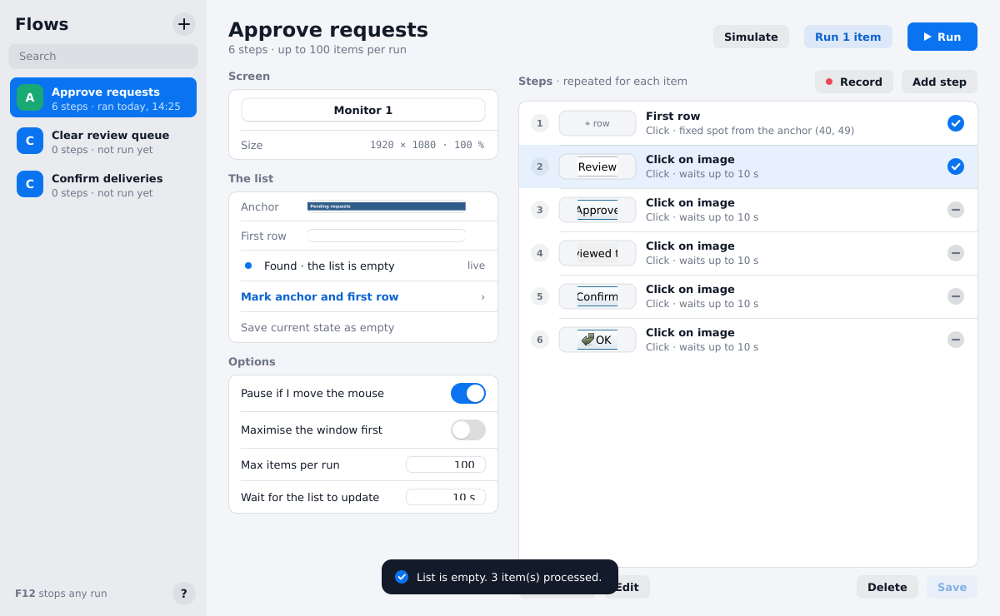

<p align="center">
  
</p>

<h1 align="center">AutoClicker Visual</h1>

<p align="center">
  <b>Clear a list of pending items in any Windows desktop app: record the clicks once, and they are repeated for every item until the list is empty.</b><br>
  Vision-based, 100&nbsp;% local, and it never clicks blindly.
</p>

<p align="center">
  <a href="https://github.com/anderescaray/autoclicker/actions/workflows/ci.yml"></a>
  
  
  <a href="LICENSE"></a>
</p>

<p align="center">
  
</p>

---

## Why

Some work is the same five clicks over and over: open the first item of a list, confirm in a dialog, accept in another one, and so on. Then you repeat it for the next item until none are left.

AutoClicker Visual automates exactly that, for people who don't write scripts:

- **It looks at the screen, like you do.** It finds buttons and the list by their appearance, so it works with any desktop app and doesn't break when a window moves.
- **It knows when to stop.** When the first row of the list is empty, the job is done.
- **It is safe by design.** If something isn't where it expects, it **stops and asks** instead of clicking "just in case".
- **Everything stays local.** It doesn't use the internet, APIs, cloud AI or integrations. It only captures the screen and moves the mouse and keyboard.

## How it works

```
 ┌──────────────┐     ┌───────────────────┐     ┌───────────────────────┐
 │ Find anchor  │ ──▶ │ First row empty?  │─yes─▶ Done: "List is empty" │
 │ (list header)│     └─────────┬─────────┘     └───────────────────────┘
 └──────▲───────┘               │ no
        │             ┌─────────▼─────────┐     ┌───────────────────────┐
        │             │ Run the recorded  │ ──▶ │ Wait until the first  │
        └──────────── │ steps (clicks,    │     │ row changes (never    │
                      │ keys, waits)      │     │ the same item twice)  │
                      └───────────────────┘     └───────────────────────┘
```

| Concept | What it is |
|---|---|
| **Flow** | A saved automation, e.g. "Approve requests". |
| **Work monitor** | The only monitor it looks at and clicks on. |
| **Anchor** | A picture of something that always looks the same near the list (e.g. its header). It's used to find the list wherever the window is. |
| **First row** | Position of the first row, relative to the anchor. If it has content, there's work left. |
| **Step** | One action: click on an image, click at a position, press a key, type text, wait, or wait for an image. |

## Features

- **Record by doing.** Click **● Record** and process one item by hand. Each click is saved with a small picture of the target that is **guaranteed unique on screen**. The crop grows automatically until it is unique.
- **No timing to tune.** Each step waits until its target appears (up to 10&nbsp;s by default).
- **Live check.** While editing, the app shows twice a second whether the anchor is found and whether the first row has an item.
- **Try before you run.** *Test step* and *Simulate* highlight where it would click without clicking. *Run 1 item* processes a single item.
- **Clear problem dialogs.** Each one shows *what I was looking for* next to *what I see now*, with concrete actions: retry, mark the list again, or stop.
- **Emergency stop.** Press **F12** (works without focus), use the Stop button, or move the mouse to a screen corner. Moving the mouse during a run **pauses** it.
- **Multi-monitor and DPI aware.** The process is per-monitor-v2 DPI aware, so captures and clicks line up at 100&nbsp;%, 125&nbsp;% and 150&nbsp;%. You're warned if the display scale changed since recording.
- **Share flows.** Export and import a flow as a single `.acvflow` file.
- **Per-user installer.** No administrator rights needed.

## Install

1. Download `AutoClickerVisual-Setup-<version>.exe`, or build it yourself (see below).
2. Run it. It installs for **your user only**, in `%LOCALAPPDATA%\Programs\AutoClickerVisual`, without administrator rights.
3. Start **AutoClicker Visual** from the Start menu. A short tutorial opens the first time.

> Windows SmartScreen may warn about an unsigned app the first time: choose **More info → Run anyway**.

## Quick start

1. Click **+** → **New flow** and give it a name.
2. Under **Screen**, pick the monitor where the list is shown.
3. **Mark anchor and first row.** The screen freezes. Drag around the list's header, then around the first row.
4. **Record** → process one item by hand → **Finish** on the black bar at the top of the screen.
5. **Simulate** and **Run 1 item** to check it.
6. **Run**. It saves the flow first, and a small panel shows the progress.

Want to practise first? Run the included demo app, which shows a list whose items each need several clicks in successive windows:

```bash
python tools/demo_list_app.py --items 10
```

## Build from source

Requirements: **Windows 10/11 x64**, **[Python 3.11+](https://www.python.org/downloads/windows/)** (3.12 recommended) and **[Inno Setup 6](https://jrsoftware.org/isdl.php)** (`winget install JRSoftware.InnoSetup`).

```powershell
git clone https://github.com/anderescaray/autoclicker.git
cd autoclicker
powershell -ExecutionPolicy Bypass -File .\build.ps1
```

The script creates a virtual environment, installs the dependencies, runs the tests, bundles the app with PyInstaller (one-folder mode) and compiles the installer:

```
dist\installer\AutoClickerVisual-Setup-1.0.0.exe
```

| Option | Effect |
|---|---|
| `-Version 1.1.0` | Sets the app version before building |
| `-SkipTests` | Skips the test suite |
| `-Clean` | Deletes `build\` and `dist\` first |
| `-IsccPath <path>` | Uses this `ISCC.exe` if Inno Setup isn't found automatically |
| `-InstallHooks` | Installs the local git hooks (see *Contributing*) |

Every pull request also builds the installer on GitHub Actions and attaches it to the run as an artifact.

Run from source without building:

```powershell
py -3.12 -m venv .venv
.venv\Scripts\pip install -r requirements.txt -r requirements-dev.txt
$env:PYTHONPATH = "src"; .venv\Scripts\python -m acv
```

## Where data is stored

| What | Where |
|---|---|
| Flows (`flow.json` + images) | `%APPDATA%\AutoClickerVisual\flows\` |
| Settings | `%APPDATA%\AutoClickerVisual\settings.json` |
| Logs (kept 14 days) and screenshots of stops | `%LOCALAPPDATA%\AutoClickerVisual\logs\` |

Uninstalling the app keeps your flows.

## Troubleshooting

| Problem | What to do |
|---|---|
| *"Cannot find the list (anchor)"* | Make sure the window is visible and not covered. Use **Show where it is…** to mark it again. |
| A step is never found | Check that the Windows display scale and the app's zoom are the same as when you recorded. Record that step again with **Add step → Click on image**. |
| *"The list has not updated"* | If the list needs a refresh, add a **Press key** step (e.g. `F5`) at the end. Or increase *Wait for the list to update*. |
| Clicks do nothing in one app | Windows blocks input from normal apps into apps running **as administrator**. Run AutoClicker Visual as administrator too. |
| An empty row is detected as "has an item" | With the list empty, click **Save current state as empty** in the editor. |
| Nothing works with the screen locked | It needs an unlocked, active desktop session (no screensaver). |

## Development

```
src/acv/
├── __main__.py        entry point: DPI awareness, logging, Qt app
├── model.py           Flow / Step data model + JSON
├── storage.py         flows, settings, logs, .acvflow import/export
├── vision.py          template matching, unique crops, empty-row detection
├── engine.py          the run loop (no GUI, no OS: fully testable)
├── recorder.py        turns real clicks/keys into steps
├── desktop.py         Windows: DPI, monitors, capture, mouse/keyboard
├── resources/         icon and stylesheet
└── ui/                PySide6 windows and dialogs
tests/                 pytest suite (fixtures rendered from the demo app)
tools/                 demo app, fixture and icon generators, git hooks
installer/             Inno Setup script
acv.spec, build.ps1    packaging
```

```powershell
$env:QT_QPA_PLATFORM = "offscreen"; .venv\Scripts\python -m pytest
```

The engine works against `ScreenProvider` / `InputController` interfaces. The tests drive it with a fake list app and a fake mouse, and cover the run loop end to end, including every stop condition.

**Stack:** Python · PySide6 · OpenCV · NumPy · mss · pynput · PyInstaller · Inno Setup.

## Contributing

Issues and pull requests are welcome. Please keep the suite green (`pytest`) and the app safe by default: when in doubt, stop and ask.

Optional local git hooks block commits that contain words you list in `.private/forbidden_words.txt`, a git-ignored file with one word per line. Install them with `.\build.ps1 -InstallHooks`.

## License

[MIT](LICENSE)
