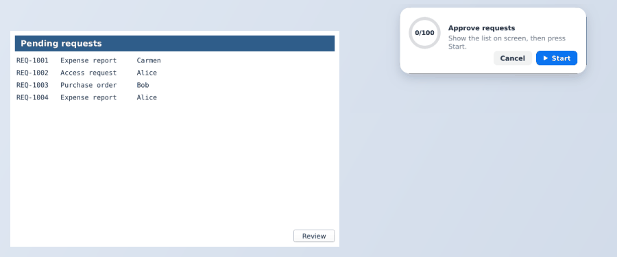
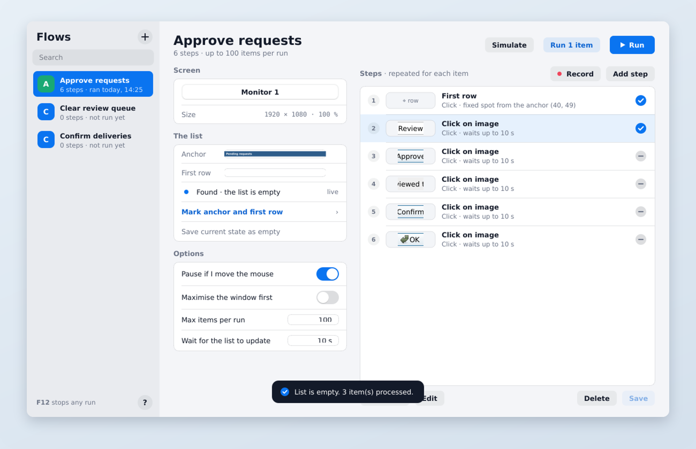
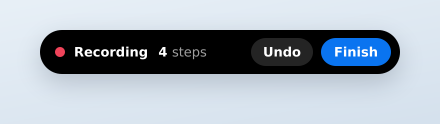
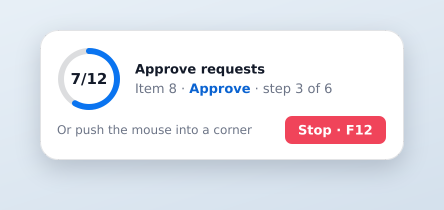
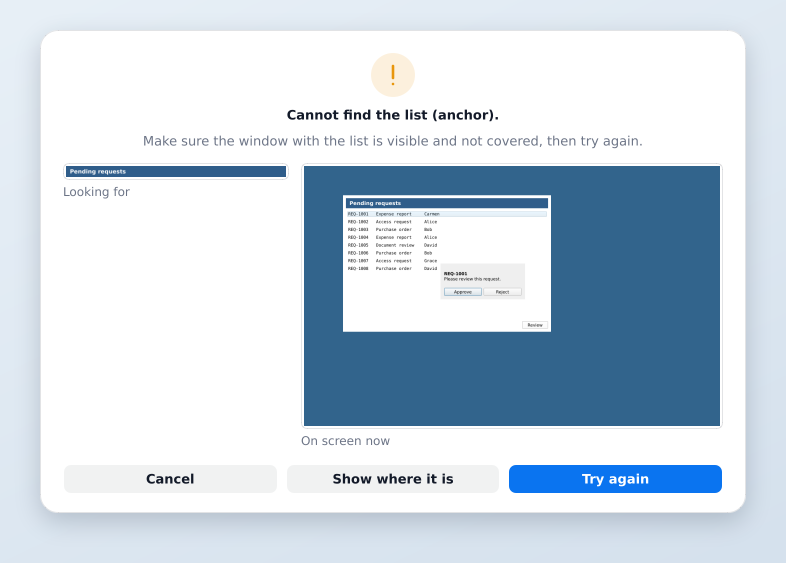

<p align="center">
  
</p>

<h1 align="center">AutoClicker Visual</h1>

<p align="center">
  <b>Clear a list of pending items in any Windows app, without doing the same clicks a hundred times.</b><br>
  You show it one item. It does the rest, item by item, until the list is empty.
</p>

<p align="center">
  <a href="https://github.com/anderescaray/autoclicker/releases/latest"></a>
  <a href="https://github.com/anderescaray/autoclicker/actions/workflows/ci.yml"></a>
  
  
  <a href="LICENSE"></a>
</p>

<p align="center">
  
  <br>
  <sub>A real run on the included demo app: four requests, five clicks each, no hands.</sub>
</p>

## What it does

Some work is the same few clicks again and again: open the first item of a list, confirm in one window, accept in the next, close the message, and start over with the next item.

AutoClicker Visual learns those clicks once and repeats them for you:

- 👀 **It looks at the screen, like you do.** It finds the list and every button by how they look, in any desktop app. Moving a window doesn't break it.
- 🔁 **It keeps going until the list is empty**, then tells you how many items it did.
- 🛑 **It never clicks blindly.** If something isn't where it should be, it stops and shows you what it was looking for next to what is on the screen.
- 🔒 **Nothing leaves your PC.** It doesn't connect to the internet or to the app. It only takes screenshots and moves the mouse and keyboard.

## How it works

<p align="center">
  
</p>

You mark two things once:

| | |
|---|---|
| **Anchor** | Something next to the list that never changes, such as its header. This is how the list is found, wherever the window is. |
| **First row** | The top row of the list. If it has something in it, there is work to do. If it's empty, the job is finished. |

Then you **record** the clicks for one item. Each click is saved as a small picture of what you clicked. When it runs, it looks for each picture on the screen before clicking it.

## A look at the app

<p align="center">
  
</p>

<table>
  <tr>
    <td width="50%" valign="top">
      
      <p><b>Record by doing.</b> Press <b>Record</b> and do one item by hand. A small bar at the top of the screen counts your clicks.</p>
    </td>
    <td width="50%" valign="top">
      
      <p><b>Run and watch.</b> A small panel shows the progress. Press <b>F12</b> at any time to stop.</p>
    </td>
  </tr>
  <tr>
    <td colspan="2" align="center">
      
      <p><b>Clear stops.</b> When something is missing, nothing more is clicked. You choose: try again, show it where the list is, or cancel.</p>
    </td>
  </tr>
</table>

## Get started

1. **Install.** Download `AutoClickerVisual-Setup-<version>.exe` from the [latest release](https://github.com/anderescaray/autoclicker/releases/latest) and run it. It installs for your user only and needs no admin rights.
2. **Create a flow.** Click **+** → **New flow** and give it a name.
3. **Mark the list.** Click **Mark anchor and first row**. The screen freezes: drag around the list's header, then around its first row.
4. **Record.** Press **Record**, do the clicks for one item, then press **Finish** on the bar at the top.
5. **Try it, then run it.** Use **Simulate** and **Run 1 item** to check. Then press **Run**, bring the list into view and press **Start**.

> **Tip:** to practise first, run the demo app from this repo: `python tools/demo_list_app.py --items 10`

## Safe by design

- Nothing is clicked until the list is found on the screen.
- Each click waits for its target first (10 seconds by default). If it's missing, or appears in two places, the run stops.
- After each item, the list must change, so the same item is never done twice.
- Moving the mouse pauses the run. **F12** or pushing the mouse into a corner of the screen stops it at once.
- Every stop is written to a log, with a screenshot, in `%LOCALAPPDATA%\AutoClickerVisual\logs`.

## Questions

<details>
<summary><b>Can I use my PC while it runs?</b></summary>

No. There is only one mouse and keyboard, and the app is using them. If you move the mouse, the run pauses and asks you what to do. Start it and let it work, for example during a break.
</details>

<details>
<summary><b>Does it work with any app?</b></summary>

With any Windows desktop app whose list and buttons you can see on the screen. It doesn't need any connection to the app. If an app runs as administrator, run AutoClicker Visual as administrator too: Windows blocks clicks from normal apps into admin apps.
</details>

<details>
<summary><b>A window takes a moment to close, and the next click comes too early.</b></summary>

Double-click the step that clicks inside that window and tick **Wait until it disappears after clicking**. The run then waits until that window has really closed.
</details>

<details>
<summary><b>The list doesn't update by itself after each item.</b></summary>

Add a step at the end with **Add step → Press key** (for example `F5`) or a click on the app's refresh button. You can also raise *Wait for the list to update* in the options.
</details>

<details>
<summary><b>I have two screens with different scaling.</b></summary>

The app finds the list on any screen. But Windows draws apps at a different size on a screen with a different display scale (100 %, 125 %…), and then the pictures don't match. Use the list on a screen with the same scale as when you marked it, or mark and record it again there.
</details>

<details>
<summary><b>Windows SmartScreen warns me when I install it.</b></summary>

The installer isn't signed with a paid certificate. Choose <b>More info → Run anyway</b>. The source code is all here, and every release is built by GitHub Actions from it.
</details>

<details>
<summary><b>Where are my flows? Can I share them?</b></summary>

In `%APPDATA%\AutoClickerVisual\flows`. Right-click a flow → **Export…** to share it as a single `.acvflow` file. Updating or uninstalling the app keeps your flows.
</details>

## Build it yourself

You need Windows 10/11, [uv](https://docs.astral.sh/uv/) or [Python 3.11+](https://www.python.org/downloads/windows/), and [Inno Setup 6](https://jrsoftware.org/isdl.php) (`winget install JRSoftware.InnoSetup`).

```powershell
git clone https://github.com/anderescaray/autoclicker.git
cd autoclicker
powershell -ExecutionPolicy Bypass -File .\build.ps1
```

This runs the tests and creates `dist\installer\AutoClickerVisual-Setup-<version>.exe`.

<details>
<summary>More build options, and running from source</summary>

| Option | What it does |
|---|---|
| `-Version 1.2.0` | Sets the app version before building |
| `-SkipTests` | Skips the tests |
| `-Clean` | Deletes `build\` and `dist\` first |
| `-IsccPath <path>` | Uses this `ISCC.exe` if Inno Setup isn't found |
| `-InstallHooks` | Installs the local git hooks (see *Contributing*) |

```powershell
py -3.12 -m venv .venv
.venv\Scripts\pip install -r requirements.txt -r requirements-dev.txt
$env:PYTHONPATH = "src"; .venv\Scripts\python -m acv
```

To publish a release: **Actions → Release → Run workflow** and type the version.
</details>

## For developers

```
src/acv/
├── engine.py        the run loop (no GUI, fully tested with a fake screen and mouse)
├── vision.py        finds pictures on the screen, checks if a row is empty
├── recorder.py      turns your real clicks into steps
├── desktop.py       Windows: screens, screenshots, mouse and keyboard
├── model.py         flows and steps, saved as JSON
├── storage.py       where flows, settings and logs live
└── ui/              the PySide6 interface
tests/               pytest suite
docs/design/         interface spec and interactive mock-up
```

```powershell
$env:QT_QPA_PLATFORM = "offscreen"; .venv\Scripts\python -m pytest
```

Built with Python, PySide6, OpenCV, NumPy, mss, pynput, PyInstaller and Inno Setup.

## Contributing

Issues and pull requests are welcome. Please keep the tests green and the app safe by default: when in doubt, stop and ask.

Optional git hooks block commits that contain words listed in `.private/forbidden_words.txt` (one per line, not tracked by git). Install them with `.\build.ps1 -InstallHooks`.

## License

[MIT](LICENSE)
